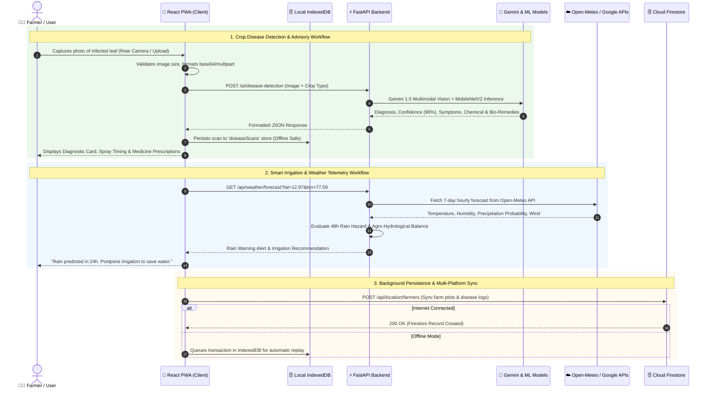

# 🌱 Agri-AI: Intelligent Precision Agriculture & Smart Farming Ecosystem

[](https://github.com/mallappadodli93-rgb/agri)
[](https://github.com/mallappadodli93-rgb/agri)
[](https://github.com/mallappadodli93-rgb/agri)
[](https://github.com/mallappadodli93-rgb/agri)
[](https://github.com/mallappadodli93-rgb/agri)
[](LICENSE)

> **Agri-AI** is a comprehensive, production-grade precision agriculture and decision support ecosystem. Designed for smallholder and commercial farmers, Agri-AI combines **Multimodal Computer Vision**, **Generative AI (Google Gemini)**, **Scikit-learn Yield Forecasting**, **ICAR/FAO Calibrated Soil Analytics**, **Open-Meteo Weather Intelligence**, **Google Maps GIS Plot Tracking**, and an **Offline-First Progressive Web App (PWA)** to maximize harvest yields, optimize resource consumption, and bridge the digital literacy gap in agriculture.

---

## 📌 Table of Contents

- [Problem Statement & Solution](#-problem-statement--proposed-solution)
- [System Architecture](#-system-architecture)
- [End-to-End System Workflow](#-end-to-end-system-workflow)
- [Key Features](#-key-features)
- [Technology Stack](#-technology-stack)
- [Source Code & Module Deep Dive](#-source-code--module-deep-dive)
  - [Frontend Client (React PWA)](#1-frontend-client-react-18--vite)
  - [Backend Services (FastAPI Architecture)](#2-backend-microservices-fastapi)
  - [AI & Machine Learning Engine](#3-aiml-models--algorithms)
  - [Database & Storage Architecture](#4-database--storage-architecture)
- [API Endpoints Reference](#-api-endpoints-reference)
- [Installation & Setup](#-installation--setup-guide)
- [Running the Project](#-running-the-project)
- [Screenshots & UI Showcase](#-screenshots--ui-showcase)
- [Future Enhancements](#-future-enhancements)
- [Contributors & Community](#-contributors--acknowledgments)
- [License](#-license)

---

## 🎯 Problem Statement & Proposed Solution

### ⚠️ The Problem
Agriculture remains the backbone of the economy, yet farmers face compounded structural challenges:
1. **Delayed Crop Disease Diagnosis**: Over 30%–40% of crop yields are lost annually to fungal, bacterial, and pest infestations because farmers lack immediate access to certified plant pathologists.
2. **Climate Volatility & Inefficient Irrigation**: Groundwater depletion and erratic precipitation lead to either over-irrigation (leaching soil nutrients and wasting power) or drought damage.
3. **Unscientific Fertilization**: Applying fertilizers without calibrated N-P-K soil analysis degrades soil ecology, lowers yield, and increases input costs.
4. **Language & Digital Literacy Barriers**: Agricultural research from universities and institutes is rarely available in vernacular dialects with intuitive voice-assisted accessibility.
5. **Spotty Rural Connectivity**: Cloud-only solutions fail in rural fields where internet access is intermittent or absent.

### 💡 The Agri-AI Solution
Agri-AI resolves these challenges through an integrated, farmer-first technological ecosystem:
- **Instant Optical Disease Diagnosis**: Farmers capture leaf photos using their mobile camera to receive real-time, high-confidence diagnoses, visual symptom breakdowns, and biological & chemical treatment remedies.
- **Precision Crop & Soil Advisory**: 100-point suitability algorithms match N-P-K levels, soil pH, moisture, climate, and season to scientifically rank the most profitable crops.
- **Smart Irrigation & Agro-Hydrology**: Evaluates 48-hour rainfall predictions to generate actionable pump schedules, saving thousands of liters of water and electricity.
- **Multilingual Generative AI Advisor**: An interactive chatbot powered by Google Gemini with live Google Search grounding and Web Speech API voice support across English, Kannada (ಕನ್ನಡ), Hindi (हिन्दी), Telugu (తెలుగు), Tamil (தமிழ்), and Marathi (मराठी).
- **Offline-First PWA & GIS Plotting**: Complete IndexedDB local persistence guarantees uninterrupted operation in remote farmland, synchronizing transparently with Google Cloud Firestore when connectivity is restored.

---

## 🏛️ System Architecture

Agri-AI is built on a modular, decoupled, 5-tier architecture ensuring high scalability, fast edge processing, and resilient data storage.

```mermaid
flowchart TD
    subgraph Client_Layer["🖥️ 1. Presentation & Client Layer (PWA)"]
        UI["React 18 + Tailwind CSS Dashboard"]
        Cam["MediaDevices Camera / Gallery Upload"]
        Voice["Web Speech API (STT Voice In / TTS Voice Out)"]
        GIS["Google Maps JS API + Geolocation"]
        SW["Service Worker (PWA Offline Engine)"]
        IDB[("Client IndexedDB\nKrishiMitra_FarmerDB")]
    end

    subgraph Gateway_Layer["🌐 2. API Gateway & Middleware Layer"]
        FastAPI["FastAPI ASGI Gateway (:8000)"]
        CORS["CORS Middleware (Cross-Origin Resource Sharing)"]
        Pydantic["Pydantic v2 Schema Validation & Serialization"]
        Logging["Structured Agricultural Logger"]
    end

    subgraph AI_Engine["🧠 3. AI & Machine Learning Intelligence Layer"]
        GeminiVision["Gemini 1.5 Multimodal Vision\n(Leaf Pathology & Plant Diagnosis)"]
        GeminiChat["Gemini LLM + Google Search Grounding\n(Multilingual Agronomic Advisory)"]
        DL_Vision["MobileNetV2 / PlantVillage CNN\n(Edge Disease & Pest Detection)"]
        RF_Yield["Scikit-Learn Random Forest Regressor\n(Harvest Yield Prediction R²=0.9695)"]
    end

    subgraph Service_Layer["⚙️ 4. Agronomic Microservices Layer"]
        WeatherSvc["Weather Service\n(Open-Meteo Real-time Telemetry)"]
        SoilSvc["Soil Health Service\n(ICAR / FAO Calibrated Assessment)"]
        CropSvc["Crop Suitability Engine\n(100-Point Agro-Climatic Matcher)"]
        IrrigationSvc["Smart Irrigation Service\n(48h Precipitation Warning System)"]
        CalendarSvc["Crop Calendar Service\n(Phenological Timeline Generator)"]
        WaterSvc["Water Asset Service\n(Borewell, Pond & Shortage Tracker)"]
    end

    subgraph Data_Layer["🗄️ 5. Data & Cloud Persistence Layer"]
        Firestore[("Google Cloud Firestore\n7 Collections Storage")]
        MockStore[("In-Memory Hot Cache\n(Zero-Credential Resilient Fallback)")]
        ExternalAPIs["External APIs:\n• Open-Meteo Weather API\n• Google Maps & Places APIs\n• APMC Mandi Data Feeds"]
    end

    %% Client Interactions
    UI --> SW
    UI <--> IDB
    Cam --> UI
    Voice --> UI
    GIS --> UI
    UI -->|REST / Multipart HTTP Requests| FastAPI

    %% Gateway Routing
    FastAPI --> CORS
    CORS --> Pydantic
    Pydantic --> Logging

    %% Routing to AI Engine
    Pydantic -->|/ai/disease-detection| GeminiVision
    Pydantic -->|/ai/chatbot| GeminiChat
    Pydantic -->|/ai/pest-detection| DL_Vision
    Pydantic -->|/ai/yield-prediction| RF_Yield

    %% Routing to Agronomic Services
    Pydantic -->|/api/weather| WeatherSvc
    Pydantic -->|/api/soil| SoilSvc
    Pydantic -->|/api/crops| CropSvc
    Pydantic -->|/api/irrigation| IrrigationSvc
    Pydantic -->|/api/calendar| CalendarSvc
    Pydantic -->|/api/water| WaterSvc

    %% External Service & Cloud Connections
    WeatherSvc --> ExternalAPIs
    FastAPI --> Firestore
    Firestore -.->|Fallback if unconfigured| MockStore
```



---

## 🔄 End-to-End System Workflow

The following sequence illustrates the interaction lifecycle when a farmer diagnoses a sick plant, receives irrigation advice, and saves their agricultural records:



---

## 🌟 Key Features

### 🍃 1. AI Plant & Leaf Disease Detection
- **Dual Capture Interface**: Live mobile rear/front camera viewfinder with real-time framing guides, plus photo gallery upload (JPG, PNG, WebP).
- **Comprehensive Multimodal Diagnosis**: Powered by Google's Gemini 1.5 Vision API and transfer-learned MobileNetV2 on PlantVillage datasets.
- **Expansive Crop Support**: Recognizes cereals (Rice, Wheat, Maize, Ragi, Sorghum), pulses (Chickpea, Pigeon Pea, Lentil), cash crops (Cotton, Sugarcane), oilseeds (Groundnut, Mustard, Soybean), and vegetables (Tomato, Potato, Chilli, Brinjal, Onion).
- **Curated Agronomic Prescriptions**: Displays disease identification confidence, early-stage symptoms, biological controls, chemical remedies, preventive cultural practices, and KVK/RSK extension escalation triggers.

### 🤖 2. Multilingual AI Farming Assistant (Voice & Chat)
- **Natural Language Understanding**: Answers natural queries on fertilizer schedules, pest control, soil pH, organic cultivation, weather patterns, and government welfare schemes.
- **Real-Time Google Search Grounding**: Connects with live agricultural databases for up-to-the-minute mandi prices and seasonal advisories.
- **Vernacular Voice Pipeline**: Full speech-to-text (STT) and text-to-speech (TTS) in **Kannada (ಕನ್ನಡ)**, **Hindi (हिन्दी)**, **English**, **Telugu**, **Tamil**, and **Marathi**.

### 🌾 3. 100-Point Precision Crop Recommendation Engine
- **Multi-Factor Soil & Climate Matching**: Evaluates Nitrogen (N), Phosphorus (P), Potassium (K), Soil pH (0–14 scale), soil texture (Black cotton, Red loam, Alluvial, Laterite), ambient temperature, and rainfall.
- **Ranked Suitability Index**: Scores candidate crops on a 100-point scale, providing season classifications (Kharif, Rabi, Zaid), water requirements, maturation periods, and expected harvest returns.

### 🗺️ 4. Interactive GIS Farm Plot & Boundary System
- **Google Maps JavaScript API Integration**: Search any village, town, taluk, district, or PIN code worldwide using Google Places Autocomplete and Geocoding APIs.
- **Boundary Polygon Drawing**: Allows farmers to draw and measure multi-corner farm plots, compute area acreage, and drop customized farm markers.
- **Multiple Farm Profiles**: Supports saving, editing, and deleting multiple plots per farmer with complete IndexedDB and Firestore persistence.

### 🌦️ 5. Real-Time Agro-Weather & 48-Hour Hazard Alerts
- **Hyper-Local Forecasts**: 7-day hourly temperature, rainfall probability, relative humidity, and wind speed sourced from the Open-Meteo API.
- **Agricultural Hazard Shield**: Automated alerts for frost warnings (< 4°C), extreme heat (> 38°C), torrential rain (> 30mm), and high winds (> 35 km/h).
- **Optimal Spraying Advisor**: Computes optimal pesticide/fertilizer spray windows based on wind velocity and rain radar predictions.

### 💧 6. Smart Irrigation & Water Asset Tracking
- **Water Balance Calculations**: Combines soil moisture sensor readings, crop phenological growth stage, and atmospheric evapotranspiration.
- **Rain Warning Interlock**: Automatically flags upcoming 48-hour rainfall to prevent unnecessary pump operation, saving energy and preserving root health.
- **Farm Water Registry**: Tracks borewell depth, open well static levels, farm ponds, and canal access with drought vulnerability scoring.

### 📅 7. Dynamic Phenological Crop Growth Calendar
- **6-Stage Visual Timeline**: Generates schedules covering Germination, Vegetative, Tillering, Heading, Grain Filling, and Physiological Maturity.
- **Automated Task Reminders**: Schedules timely alerts for basal fertilizer dressing, top dressing, weed scouting, and harvest preparation.

### 📊 8. APMC Mandi Market Commodity Rates
- Real-time price tracking for major agricultural commodities across APMC mandis.
- Visual trend charts, modal price benchmarks, daily minimum/maximum ranges, and market arrival volumes.

### 📴 9. Offline-First Architecture (PWA + IndexedDB)
- **Zero Data Loss**: Operates seamlessly in deep rural farmland without internet access.
- **Robust Client Storage**: 7 dedicated IndexedDB object stores cache farmer profiles, farm boundaries, disease scans, schedules, and reminders.
- **Automatic Sync**: Queues local changes and synchronizes transparently when the mobile device reconnects.

---

## 🛠️ Technology Stack

| Layer | Technology | Version | Purpose in Agri-AI |
| :--- | :--- | :--- | :--- |
| **Frontend Framework** | **React** | `18.3.1` | Component-based, reactive user interface |
| **Build Tool & Bundler** | **Vite** | `6.0.7` | Lightning-fast HMR and optimized production bundling |
| **Styling & Design** | **Tailwind CSS** | `3.4.17` | Responsive mobile-first agricultural theme |
| **UI Icons** | **Lucide React** | `1.16.0` | Crisp, accessible iconography across all dashboards |
| **Client Database** | **IndexedDB** | Native (v5) | 7-store local offline persistence engine |
| **Maps & GIS** | **Google Maps API** | JS API v3 | Geolocation, place search, farm boundary polygons |
| **Client AI Integration** | **@google/genai** | `3.0.0` | Client-side Gemini multimodal streaming |
| **Backend Framework** | **FastAPI** | `>=0.115.0` | High-performance Python ASGI backend server |
| **ASGI Server** | **Uvicorn** | `>=0.30.0` | Production ASGI web server running API microservices |
| **Data Validation** | **Pydantic** | `>=2.8.0` | Strict type validation and automatic OpenAPI schema |
| **Cloud Database** | **Google Cloud Firestore** | `6.5.0` | 7-collection NoSQL cloud database via Firebase Admin SDK |
| **Deep Learning** | **TensorFlow / Keras** | `>=2.15.0` | MobileNetV2 leaf disease and pest classification models |
| **Computer Vision** | **OpenCV / Pillow** | `>=4.9.0` | Image preprocessing, resizing, matrix normalization |
| **Machine Learning** | **Scikit-Learn** | `>=1.5.0` | Random Forest Regression for harvest yield forecasting |
| **Data Analysis** | **Pandas / NumPy** | `>=2.2.0` | Agronomic tabular datasets and tensor processing |
| **Weather Telemetry** | **Open-Meteo API** | v1 REST | Free, high-resolution global agricultural weather |
| **Voice Processing** | **Web Speech API** | Native | Speech Recognition (STT) and Speech Synthesis (TTS) |

---

## 📂 Source Code & Module Deep Dive

```text
agri/
├── app/                           # Primary FastAPI AI/ML microservices application
│   ├── config.py                  # AI/ML server environment settings & model paths
│   ├── main.py                    # Root FastAPI app, router registration & OpenAPI metadata
│   └── routes/                    # API route handlers
│       ├── ai_service_routes.py   # Unified /ai/* endpoints
│       ├── chatbot_routes.py      # AI chatbot conversation handler
│       ├── crop_routes.py         # Crop recommendation endpoint
│       ├── disease_routes.py      # Leaf disease detection endpoint
│       ├── farm_doctor_routes.py  # Comprehensive farm doctor advisory
│       ├── pest_routes.py         # Pest identification endpoint
│       ├── voice_routes.py        # Voice processing endpoint
│       └── yield_routes.py        # Crop yield prediction endpoint
│
├── backend/                       # Member 3 Module: Weather, Soil, Crops, Irrigation & GIS
│   ├── API_INTEGRATION_GUIDE.md   # Teammate guide with cURL and JSON payloads
│   ├── README.md                  # Dedicated Member 3 backend documentation
│   ├── requirements.txt           # Backend Python dependencies
│   ├── app/
│   │   ├── config.py              # Environment configuration & alert thresholds
│   │   ├── main.py                # Standalone FastAPI server for Member 3
│   │   ├── api/                   # API endpoint routers
│   │   │   ├── calendar.py        # Crop growth calendar endpoints
│   │   │   ├── crops.py           # 100-point crop recommendation endpoints
│   │   │   ├── irrigation.py      # Irrigation advisory & rain warning endpoints
│   │   │   ├── location.py        # Farmer GPS coordinates & farm profile endpoints
│   │   │   ├── soil.py            # Soil test analysis (NPK, pH, health score)
│   │   │   ├── water.py           # Farm water asset & shortage risk endpoints
│   │   │   └── weather.py         # Real-time weather, forecasts & hazard alerts
│   │   ├── database/
│   │   │   └── firebase.py        # Google Cloud Firestore client (7 collections) + fallback
│   │   ├── models/
│   │   │   └── schemas.py         # Pydantic v2 validation models
│   │   ├── services/              # Pure agronomic algorithms & API integrations
│   │   │   ├── calendar_service.py# Stage-by-stage growth timeline generator
│   │   │   ├── crop_service.py    # 100-point multi-factor crop suitability engine
│   │   │   ├── irrigation_service.py # Agro-hydrological water balance calculator
│   │   │   ├── soil_service.py    # ICAR/FAO soil screening & biofertilizer advice
│   │   │   ├── water_service.py   # Water asset analytics & conservation tips
│   │   │   └── weather_service.py # Open-Meteo integration & hazard alert rules
│   │   └── utils/
│   │       └── helpers.py         # JSON formatting & standard response envelopes
│   └── tests/                     # Comprehensive Pytest suite
│       ├── test_calendar_live.py  # Crop calendar timeline verification
│       ├── test_crops_live.py     # Crop suitability algorithm verification
│       ├── test_firebase_operations.py # Firestore read/write verification
│       ├── test_irrigation_live.py# Rain warning logic verification
│       ├── test_master_integration.py # 20-endpoint full integration test suite
│       ├── test_soil_live.py      # Multi-sample soil benchmark testing
│       ├── test_structure.py      # Backend structural integrity test
│       ├── test_water_live.py     # Water asset registration testing
│       └── test_weather_live.py   # Live Open-Meteo telemetry testing
│
├── modules/                       # Core Machine Learning & Intelligence Models
│   ├── chatbot/                   # Google Gemini multilingual agronomic assistant
│   ├── crop_classification/       # Deep learning crop classification
│   ├── disease_detection/         # MobileNetV2 leaf disease classifier
│   ├── farm_doctor/               # Clinical farm diagnostic engine
│   ├── pest_identification/       # Pest classification & IPM protocols
│   ├── voice_assistant/           # Audio processing & voice response pipeline
│   └── yield_prediction/          # Scikit-learn Random Forest regression model
│
├── public/                        # PWA Assets & Web Manifest
│   ├── manifest.json              # Progressive Web App manifest
│   ├── sw.js                      # Service Worker for offline asset caching
│   └── icons/                     # SVG & PNG app launcher icons
│
├── src/                           # React 18 Frontend Application
│   ├── App.jsx                    # Root component, routing dispatcher & state
│   ├── index.css                  # Tailwind CSS styling directives
│   ├── main.jsx                   # React DOM application mount
│   ├── components/                # Modular UI components
│   │   ├── auth/                  # Login, registration, profile modals
│   │   ├── common/                # Reusable Buttons, Cards, Badges, Modals, ErrorBoundary
│   │   ├── dashboard/             # Farmer dashboard overview, header, sidebar
│   │   ├── features/              # Feature modals (Crop recommendation, Soil info)
│   │   ├── home/                  # Landing page (Hero, Features, Weather, Testimonials)
│   │   ├── layout/                # Navbar, Footer, Notification banner
│   │   └── offline/               # Offline status banners & guides
│   ├── context/                   # React Context Providers
│   │   ├── LanguageContext.jsx    # Multilingual state (ಕನ್ನಡ, English, हिन्दी, etc.)
│   │   └── OfflineContext.jsx     # Network connectivity & sync state
│   ├── pages/                     # Full-Page Views
│   │   ├── AIAssistantPage.jsx    # Multilingual Gemini chat & voice interface
│   │   ├── CropRecommendationPage.jsx # Precision soil & climate crop planning
│   │   ├── DashboardPage.jsx      # Farmer management command center
│   │   ├── DiseaseDetectionPage.jsx # AI leaf camera scanner & diagnosis
│   │   ├── FarmerProfilePage.jsx  # Farmer bio & farm property details
│   │   ├── FarmingCalendarPage.jsx# Crop growth schedules & reminders
│   │   ├── LocationSelectionPage.jsx # Google Maps GIS plot manager & boundary drawing
│   │   ├── MarketPricesPage.jsx   # APMC Mandi rates & market trends
│   │   ├── MyFarmingRecordsPage.jsx # Saved crop records, acreages & scan logs
│   │   └── WeatherPage.jsx        # Hyper-local weather & hazard warnings
│   ├── services/                  # Frontend API & Intelligence Connectors
│   │   ├── cropDiseaseAIService.js# AI disease detection service adapter
│   │   ├── cropRecommendationService.js # Crop suitability calculation client
│   │   ├── farmerDataService.js   # Local record calculations & IndexedDB queries
│   │   ├── geminiChatService.js   # Gemini chat client with search grounding
│   │   ├── geminiDiseaseService.js# Gemini multimodal vision diagnosis
│   │   ├── marketPriceService.js  # Mandi rate data service
│   │   └── plantDiseaseKnowledge.js # Multi-crop plant pathology database
│   └── utils/                     # Storage & Helper Utilities
│       ├── authStorage.js         # User session & credentials storage
│       ├── indexedDBStorage.js    # IndexedDB wrapper (7 Object Stores)
│       └── translations.js        # Multilingual vocabulary dictionaries
│
├── package.json                   # Frontend dependencies & scripts
├── requirements.txt               # AI/ML Python requirements
├── server.py                      # Unified FastAPI production server launcher
├── tailwind.config.js             # Tailwind CSS theme configuration
└── vite.config.js                 # Vite bundler configuration
```

---

## 📡 API Endpoints Reference

The unified FastAPI backend exposes production-ready endpoints documented with interactive **Swagger UI** at `http://localhost:8000/docs`.

### 1. Primary AI/ML Microservices (`/ai/*`)

| Endpoint | Method | Input Format | Output Format | Description |
| :--- | :---: | :--- | :--- | :--- |
| `/ai/disease-detection` | `POST` | `multipart/form-data` (file, crop_type) | `application/json` | Analyzes crop leaf photos for diseases, severity, and treatments. |
| `/ai/pest-detection` | `POST` | `multipart/form-data` (file) | `application/json` | Identifies agricultural pests and prescribes IPM protocols. |
| `/ai/yield-prediction` | `POST` | `application/json` | `application/json` | Forecasts harvest tonnage (tons/hectare) using Random Forest regression. |
| `/ai/chatbot` | `POST` | `application/json` (message, language) | `application/json` | Vernacular conversational advice via Gemini with search grounding. |
| `/ai/farm-doctor` | `POST` | `multipart/form-data` | `application/json` | Diagnostic combining leaf vision, weather, and agronomic factors. |
| `/ai/voice-assistant` | `POST` | `multipart/form-data` (audio file) | `application/json` | End-to-end voice loop: Speech-to-Text $\rightarrow$ Gemini $\rightarrow$ Audio Response. |

### 2. Weather, Soil, Crops, Irrigation & GIS Endpoints (`/api/*`)

| Endpoint | Method | Key Parameters | Description |
| :--- | :---: | :--- | :--- |
| `/api/weather/current` | `GET` | `latitude`, `longitude` | Current temperature, humidity, precipitation, and wind speed. |
| `/api/weather/forecast` | `GET` | `latitude`, `longitude`, `days=7` | 7-day hourly forecast with agricultural hazard alerts. |
| `/api/soil/analyze` | `POST` | `nitrogen`, `phosphorus`, `potassium`, `ph` | ICAR soil fertility index, nutrient deficiencies, and fertilizer advice. |
| `/api/crops/recommend` | `POST` | `soil_type`, `ph`, `water_availability`, `season` | 100-point ranked crop suitability list with agronomic guidelines. |
| `/api/irrigation/recommend` | `POST` | `crop_type`, `growth_stage`, `soil_moisture` | Dynamic irrigation advice factoring in 48-hour rainfall predictions. |
| `/api/calendar/generate` | `POST` | `crop_type`, `sowing_date` | 6-stage crop growth timeline with activity and monitoring reminders. |
| `/api/water/register` | `POST` | `source_type`, `capacity_liters`, `status` | Registers farm water assets (borewell, pond, canal) with shortage risk index. |
| `/api/location/farmers` | `POST` | `farmer_id`, `name`, `farm_locations` | Stores farm GPS coordinates and boundary polygons in Firestore. |

---

## ⚡ Installation & Setup Guide

### 📋 Prerequisites
- **Node.js**: `v18.0.0` or higher (`v20+` recommended)
- **Python**: `v3.10` or `v3.11`
- **Git**: Installed on your system
- *(Optional)* **Google Gemini API Key**: For live LLM chat and vision diagnosis
- *(Optional)* **Google Maps JavaScript API Key**: For interactive GIS maps

---

### 1. Clone the Repository

```bash
git clone https://github.com/mallappadodli93-rgb/agri.git
cd agri
```

---

### 2. Frontend Configuration & Setup

```bash
# Install frontend npm dependencies
npm install

# Create environment configuration file
cp .env.example .env
```

Configure your `.env` file in the project root:
```ini
# Google Maps JavaScript API Key (Optional: App falls back to interactive plot simulator if omitted)
VITE_GOOGLE_MAPS_API_KEY=your_google_maps_api_key_here

# Google Gemini API Key (Optional: App uses agronomic knowledge base if omitted)
VITE_GEMINI_API_KEY=your_gemini_api_key_here
```

---

### 3. Backend Configuration & Setup

Open a separate terminal window and configure the Python environment:

```bash
# Create a Python virtual environment
python -m venv .venv

# Activate virtual environment
# On macOS / Linux:
source .venv/bin/activate
# On Windows (Command Prompt):
# .venv\Scripts\activate.bat
# On Windows (PowerShell):
# .venv\Scripts\Activate.ps1

# Upgrade pip and install dependencies
pip install --upgrade pip
pip install -r requirements.txt
pip install -r backend/requirements.txt
```

---

## 🚀 Running the Project

### Start the Frontend Application

```bash
npm run dev
```
The React Progressive Web App will be live at:
👉 **`http://localhost:5173`** (or `http://localhost:3000`)

To build the optimized production bundle:
```bash
npm run build
```

---

### Start the Unified AI & Backend Server

```bash
# Ensure virtual environment is active
source .venv/bin/activate

# Launch the unified server
python server.py
```
*Alternatively, run via Uvicorn directly:*
```bash
python -m uvicorn app.main:app --host 0.0.0.0 --port 8000 --reload
```

Once running, access the interactive API docs:
- **Swagger UI Interactive Explorer**: 👉 **`http://localhost:8000/docs`**
- **ReDoc Technical Specification**: 👉 **`http://localhost:8000/redoc`**
- **System Health Endpoint**: 👉 **`http://localhost:8000/health`**

---

### Run Test Suites

The backend includes a comprehensive Pytest suite covering all integration endpoints, ML inferences, and agronomic logic:

```bash
# Run all backend integration tests
pytest backend/tests/ -v

# Run AI/ML module tests
pytest tests/ -v
```

---

## 📸 Screenshots & UI Showcase

| 🌾 Farmer Command Dashboard | 🍃 AI Leaf Disease Scanner |
| :---: | :---: |
|  <br> *Real-time farm metrics, crop advisory, weather cards & quick actions.* |  <br> *Live camera scan, instant disease diagnosis, and biological remedies.* |

| 🗺️ Google Maps GIS Plot Manager | 💬 Multilingual AI Assistant |
| :---: | :---: |
|  <br> *Satellite & normal views, GPS location, and polygon boundary drawing.* |  <br> *Vernacular voice Q&A, Gemini intelligence, and search grounding.* |

---

## 🔮 Future Enhancements

- [ ] **IoT LoRaWAN Sensor Mesh**: Direct telemetry ingestion from in-situ soil moisture, N-P-K probes, and micro-weather stations.
- [ ] **Drone & Multispectral Imaging**: Aerial crop canopy stress mapping and automated NDVI (Normalized Difference Vegetation Index) calculation.
- [ ] **Satellite Earth Observation**: Automated integration with Sentinel-2 and Landsat-8 imagery for district-scale drought and yield prediction.
- [ ] **Decentralized Mandi Contracts**: Smart contract agreements ensuring fair minimum support price (MSP) enforcement and transparent buyer-seller settlements.
- [ ] **Edge TPU Offline Inference**: Quantized TensorFlow Lite models running directly on entry-level Android devices without cloud dependency.

---

## 👥 Contributors & Acknowledgments

Developed with dedication to empower farming communities and champion technological innovation in Indian agriculture.

- **Lead Developer & System Architect**: [Mallappa Dodli](https://github.com/mallappadodli93-rgb)
- **Agricultural Research & Datasets**: Inspired by agronomic publications from ICAR (Indian Council of Agricultural Research), FAO (Food and Agriculture Organization), and the PlantVillage open dataset.
- **External Services**: Weather data by [Open-Meteo](https://open-meteo.com/), generative AI by [Google Gemini](https://ai.google.dev/).

---

## 📄 License

This project is licensed under the **MIT License** — feel free to explore, learn, modify, and build upon this platform to foster sustainable agricultural innovation.

```text
Copyright (c) 2026 Agri-AI Contributors

Permission is hereby granted, free of charge, to any person obtaining a copy
of this software and associated documentation files (the "Software"), to deal
in the Software without restriction, including without limitation the rights
to use, copy, modify, merge, publish, distribute, sublicense, and/or sell
copies of the Software, and to permit persons to whom the Software is
furnished to do so, subject to the following conditions:

The above copyright notice and this permission notice shall be included in all
copies or substantial portions of the Software.
```

<div align="center">
  <sub>Built with ❤️ for sustainable, resilient, and intelligent farming across the globe.</sub>
</div>
